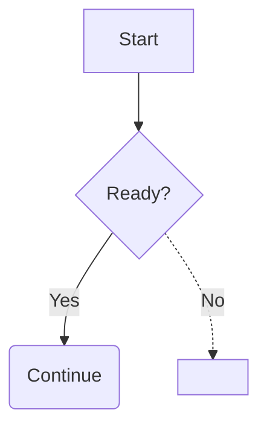
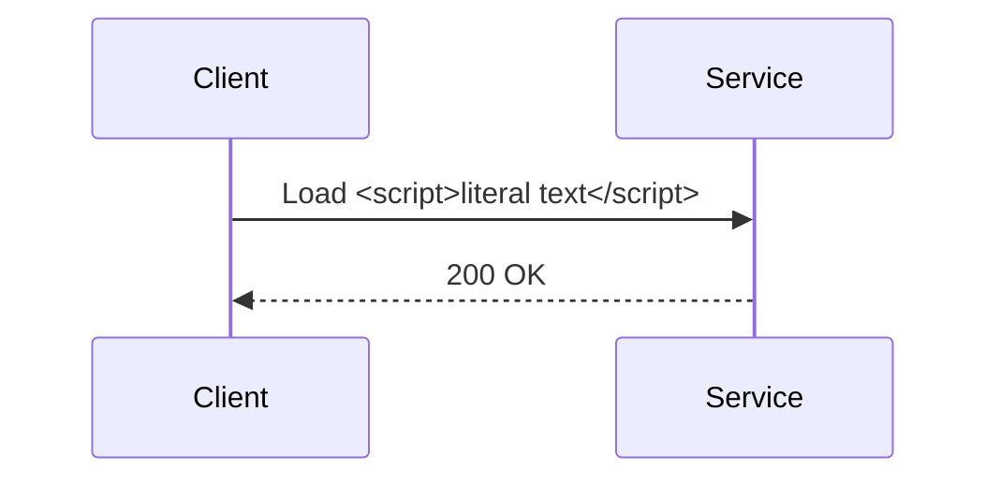
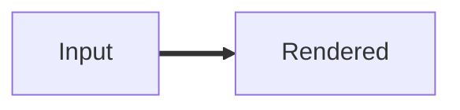
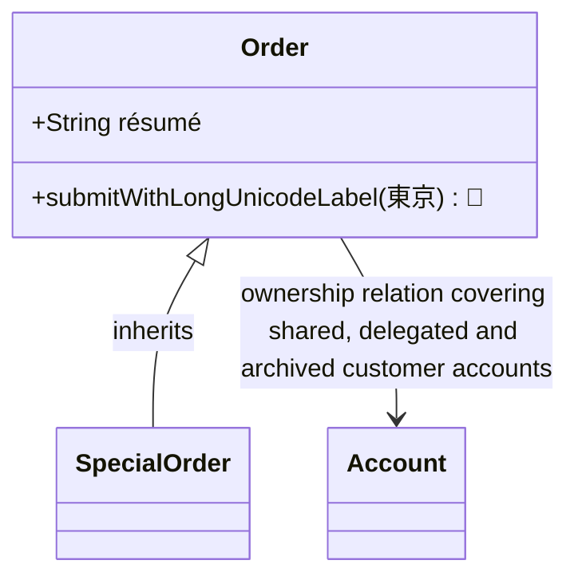
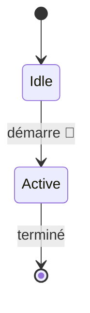

# Flowchart and Math {#overview}

This *representative* document combines **CommonMark**, ~~GFM~~, inline math $x^2 + \alpha_i$,
and a local rendering path. Inline `$x^2$` stays code.

Return to the [overview](#overview) after reviewing the diagrams.

> A block quote keeps its ordinary Markdown meaning beside native attachments.

- [ ] Review the first item
- [x] Confirm the completed item

The note below has a reference[^rendering].

[^rendering]: Footnotes keep their text and number references by first use.

!!! note
    This admonition sits beside ordinary Markdown and keeps its readable body.

```swift
let literal = "```mermaid flowchart TD A --> B``` and $x^2$ stay code"
```

Display math stays centered and native:

$$
\frac{a}{b} = \sqrt{x}
$$




| Result | Formula |
|---|---|
| Done | $\sqrt{x}$ |









## After the diagrams

This heading and its navigation remain intact.
