## agentflow.mmd

```mermaid
agentflow TB
  flow reviewer["Review Agent"]
    changes["Gather changes"]@{ shape: input }
    analyse["Analyse diff"]@{ shape: task }
    inspect["run_linter"]@{ shape: tool }
    decision["Clean?"]@{ shape: decision }

    changes --> analyse --> inspect --> decision
  end
```

## architecture.mmd

```mermaid
architecture-beta
  group client(cloud)[Client]
  group preview(server)[Preview]
  service finder(browser)[Finder] in client
  service extension(server)[Quick Look] in preview
  service core(database)[Inspector Core] in preview
  finder:R --> L:extension
  extension:B --> T:core
```

## block.mmd

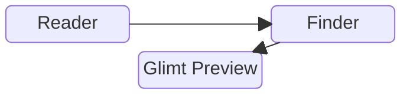

## c4.mmd

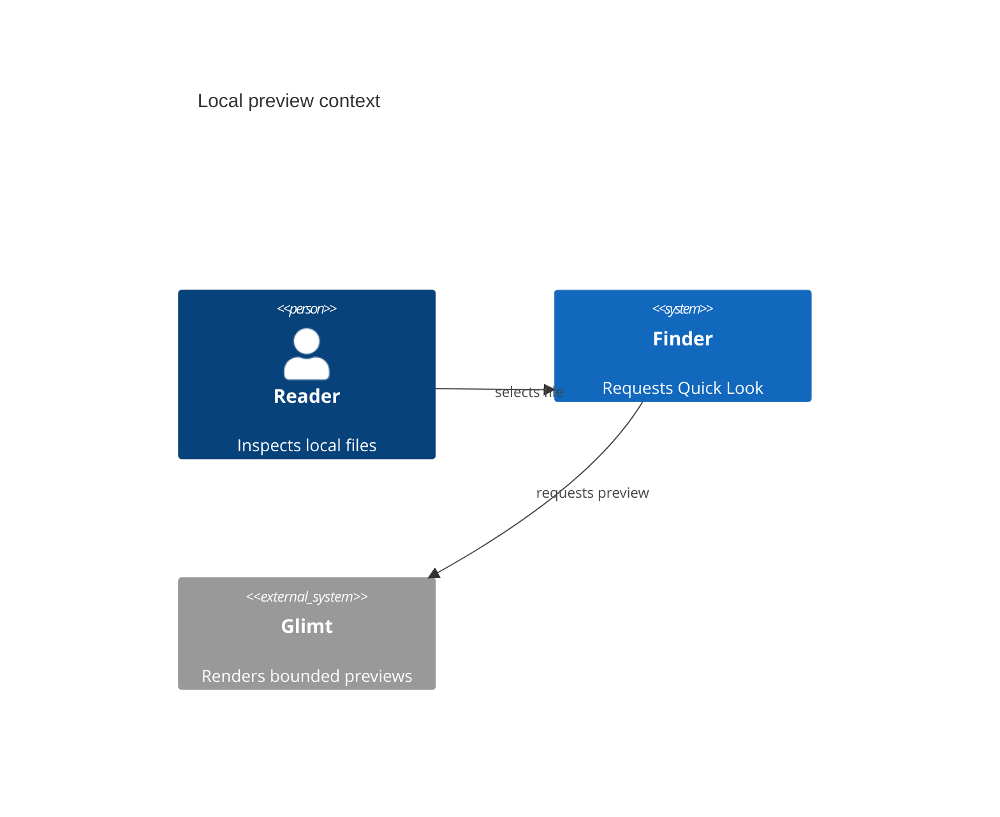

## class.mmd

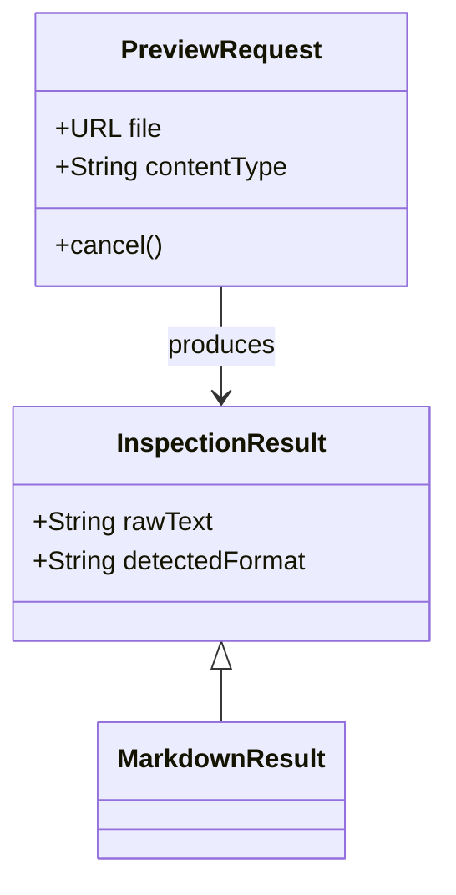

## cynefin.mmd

```mermaid
cynefin-beta
  title Input handling
  clear
    "Known text format"
  complicated
    "Structured file"
  complex
    "Unknown content"
  chaotic
    "Malformed input"
```

## entity-relationship.mmd

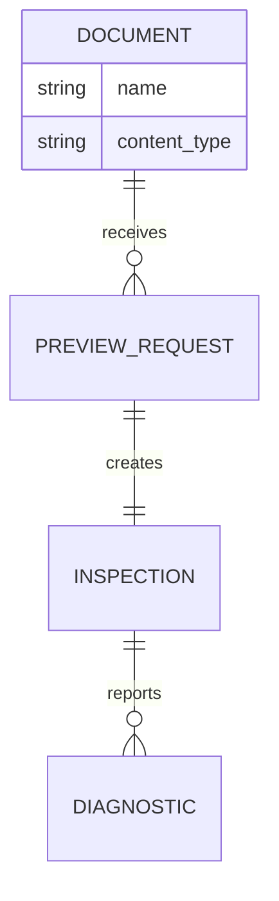

## event-modeling.mmd

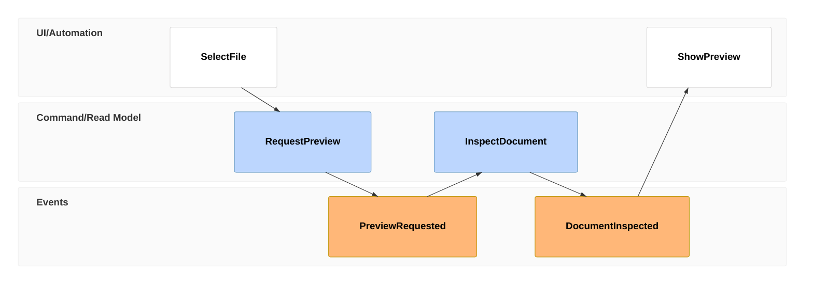

## flowchart.mmd

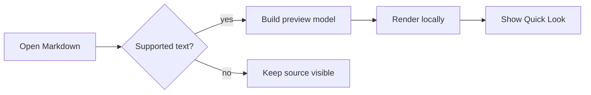

## gantt.mmd

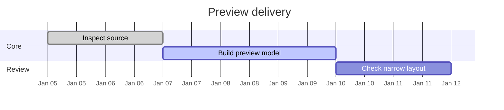

## git-graph.mmd

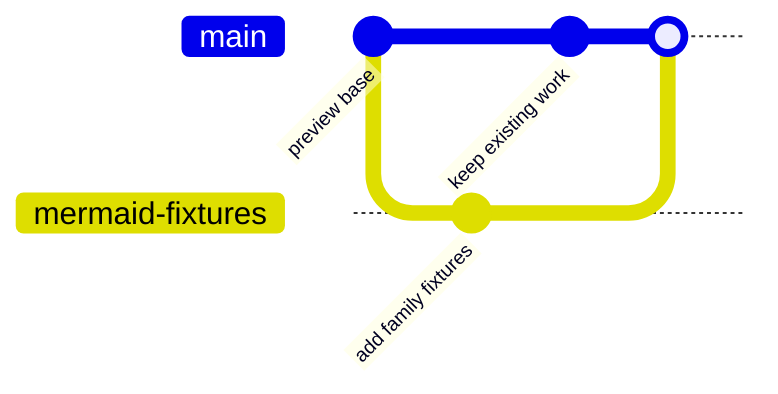

## ishikawa.mmd

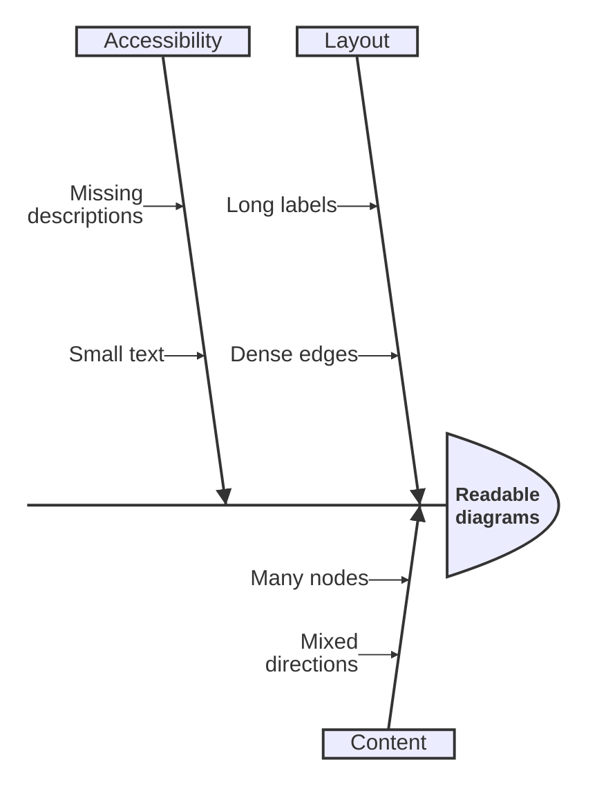

## kanban.mmd

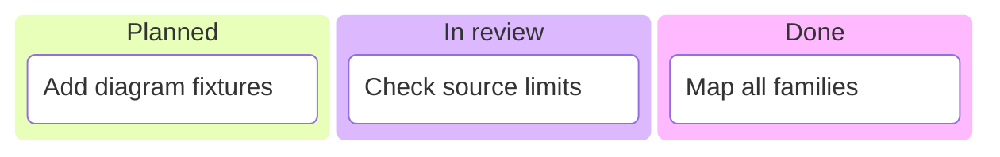

## mindmap.mmd

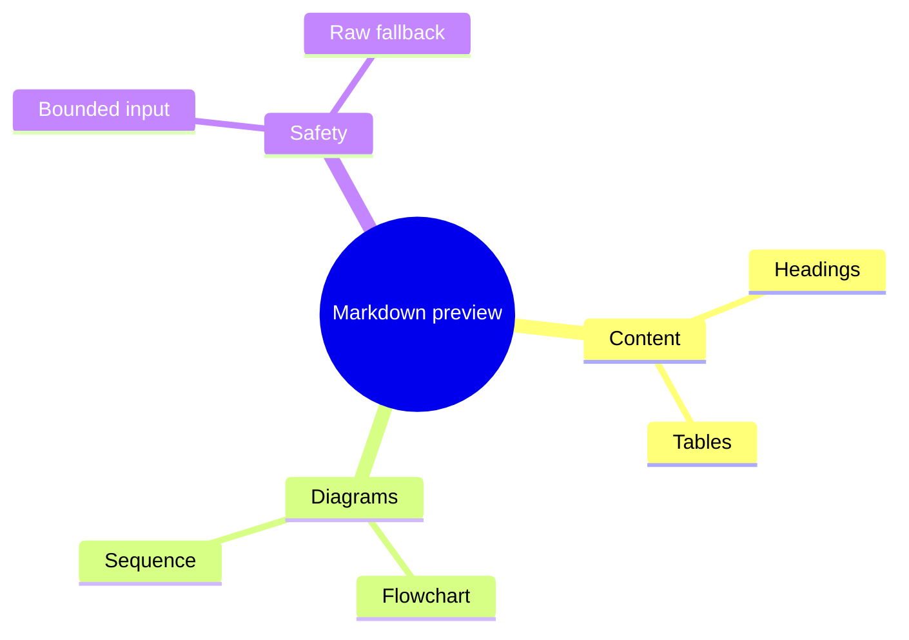

## packet.mmd

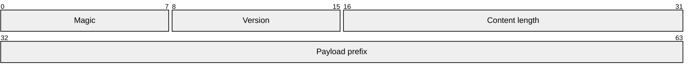

## pie.mmd

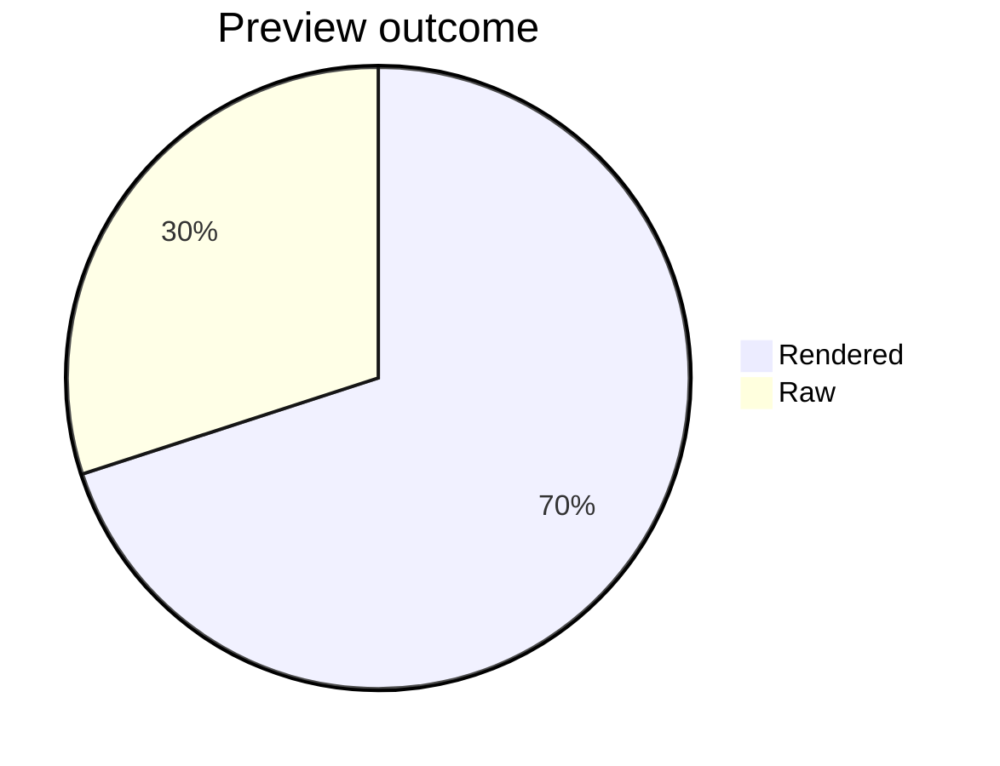
