## quadrant.mmd

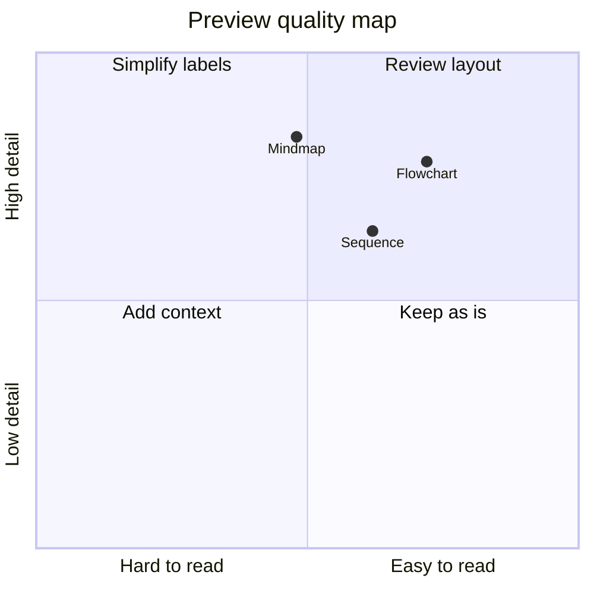

## radar.mmd

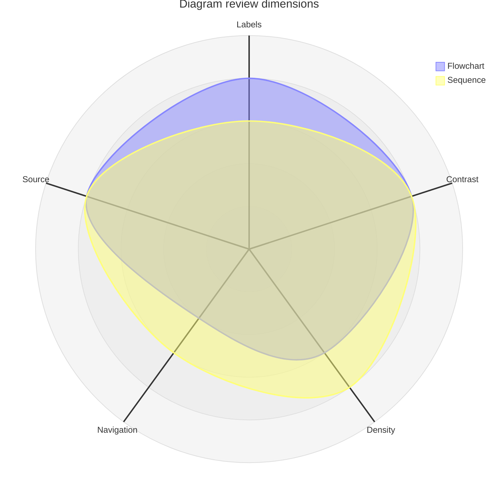

## requirement.mmd

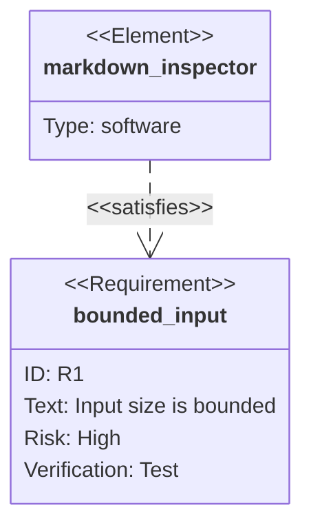

## sankey.mmd

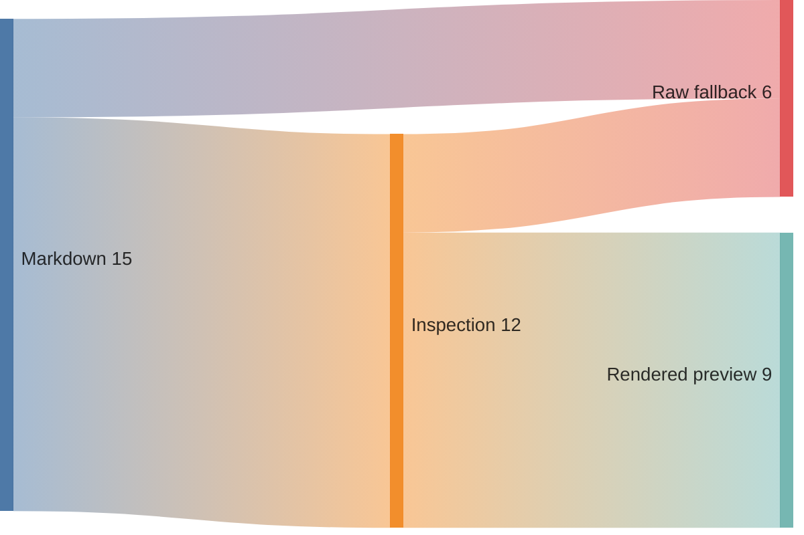

## sequence.mmd

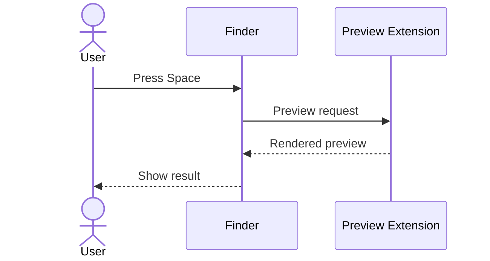

## state.mmd

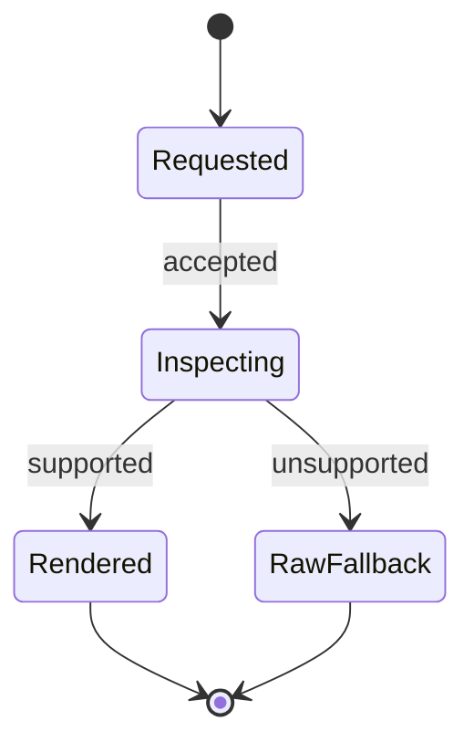

## swimlanes.mmd

```mermaid
swimlane-beta LR
subgraph Finder
  Select[Select file]
  Preview[Request preview]
end
subgraph Glimt
  Inspect[Inspect bounded input]
  Render[Render diagram]
end
Select --> Preview --> Inspect --> Render
```

## timeline.mmd

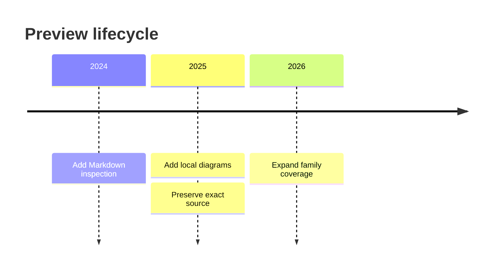

## tree-view.mmd


## treemap.mmd

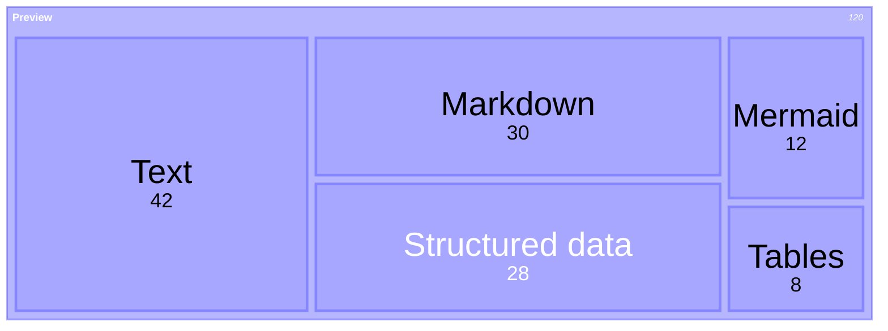

## use-case.mmd

```mermaid
usecase-beta
  direction LR
  actor Reader("Technical reader")
  systemBoundary "Glimt Preview"
    Inspect("Inspect file")
    Source("View source")
    Diagram("View diagram")
  end
  Reader --> Inspect
  Reader --> Source
  Reader --> Diagram
```

## user-journey.mmd

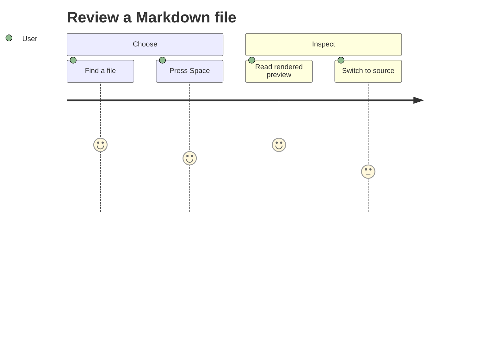

## venn.mmd

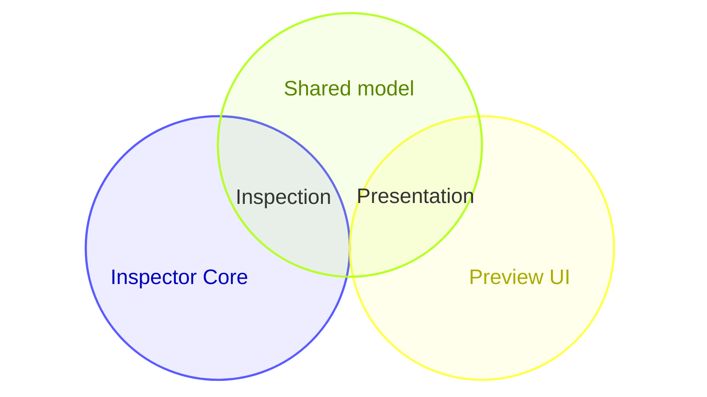

## wardley.mmd

```mermaid
wardley-beta
  title Local preview components
  anchor User [0.9, 0.8]
  component Finder [0.8, 0.65]
  component Quick Look [0.65, 0.5]
  component Inspector [0.45, 0.35]
  User -> Finder
  Finder -> Quick Look
  Quick Look -> Inspector
```

## xy-chart.mmd

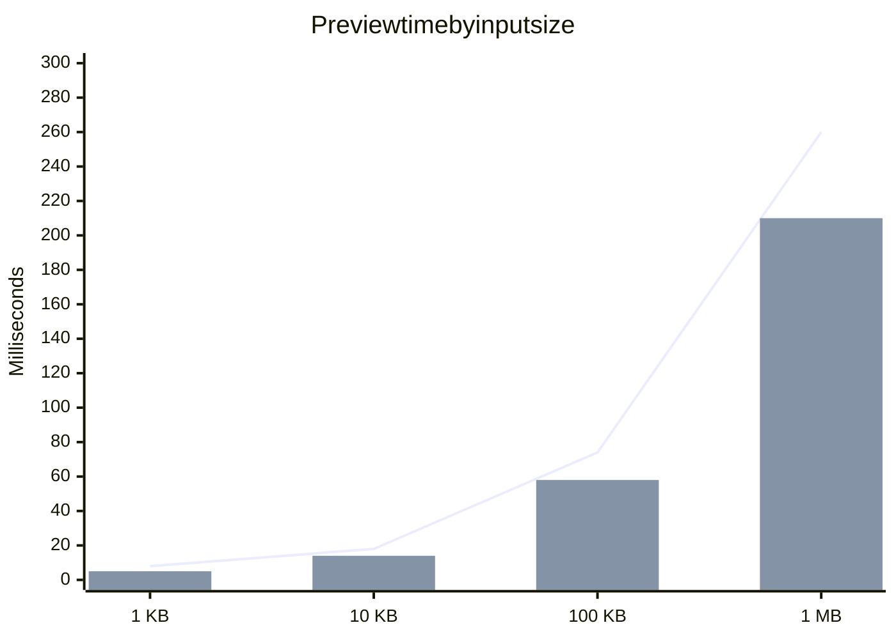

## zenuml.mmd

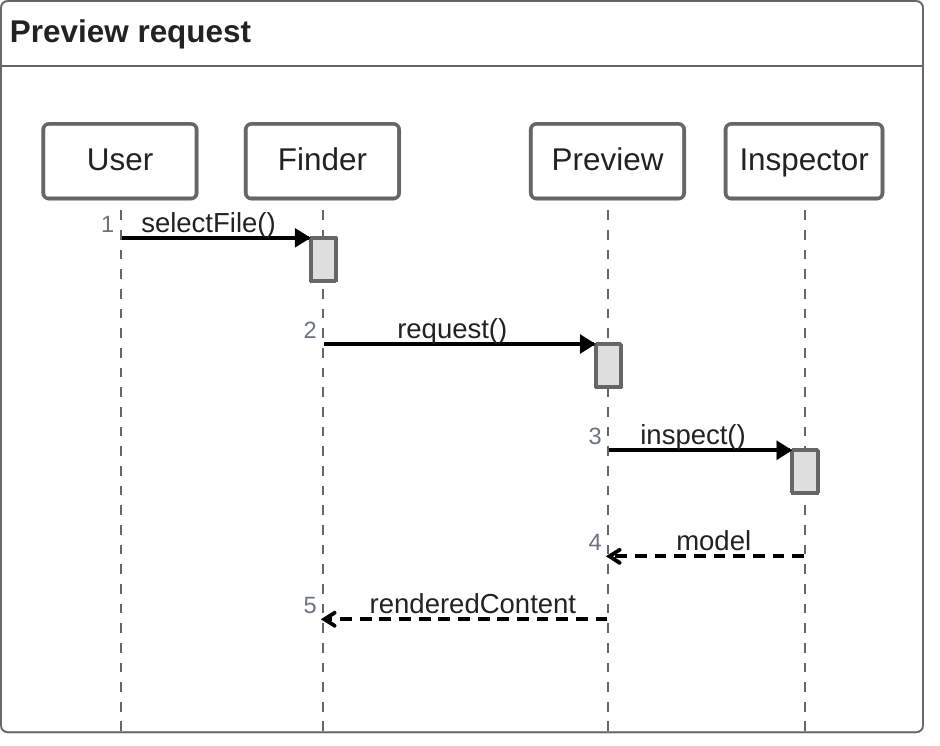
