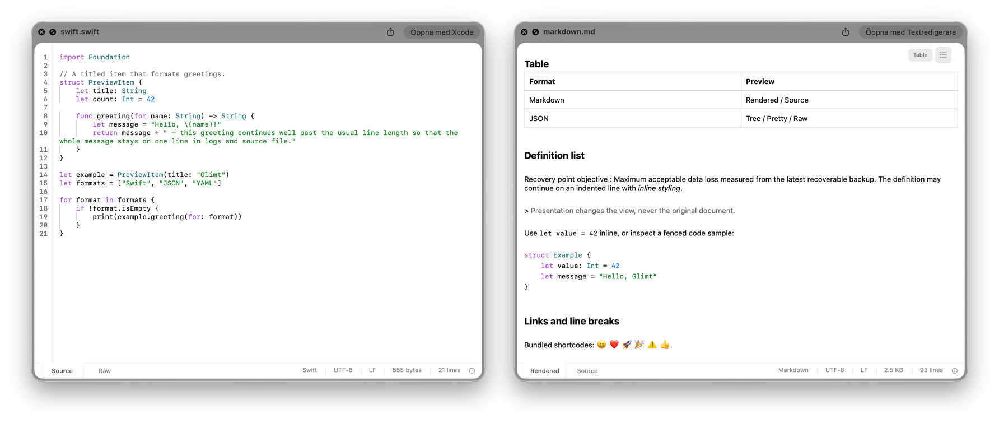

# Glimt

  
  
  
  
  
  
  
  
  
  
  

Glimt adds Quick Look previews for source code, Markdown and structured data to macOS. Select a
file in Finder and press Space to see it highlighted, rendered or laid out as a tree, with Raw and
Hex always one click away. Glimt is local and read-only: it never runs or changes the files it
shows, and it does not use the network.

## Features

- Syntax-highlighted source with line numbers for programming, markup, configuration and template
  languages.
- Rendered Markdown with support for most formatting, such as tables, footnotes, math and Mermaid
  diagrams, and a dynamic table of contents.
- Tree, Pretty and Table views for JSON, YAML, XML, property lists, CSV, logs, certificates,
  SQLite schemas and more. Archives are listed, never extracted.
- Finder thumbnails from the same engine.
- An app for opening files directly, changing appearance and choosing which views each format
  offers.

## System Requirements

macOS 15 or later, on Apple silicon or Intel. Glimt needs no special permissions.

## Installation

1. Download `Glimt-<version>-macOS.zip` from
   [GitHub Releases](https://github.com/HansJoakimPersson/Glimt/releases).
2. Unzip it and move `Glimt.app` to `/Applications`.
3. Open Glimt once. Beta builds are not notarized yet, so macOS blocks the first launch: choose
   **Done**, open **System Settings › Privacy & Security**, click **Open Anyway** next to the
   message about Glimt and confirm.

## How to Use It

Select a file in Finder and press Space, or open the Preview pane. The tabs at the bottom switch
between the file's views, such as Source, Rendered, Tree and Raw.

In the app, `File › Open File…` (⌘O) opens any file, and the settings beside the preview control
appearance, fonts and wrapping. `View › Formats & Views…` (⌘1) chooses each format's views and
which one opens first. Quick Look uses the same settings.

## Supported Formats

- **Source code and markup:** Swift, Python, JavaScript/TypeScript, C/C++, Java, Rust, Go, Shell,
  HTML, CSS, templates such as Jinja and ERB, and many more.
- **Documents:** Markdown, TextBundle, Mermaid, AsciiDoc, Org.
- **Data:** JSON, YAML, XML, TOML, property lists, CSV/TSV, JSON Lines, logs, iCalendar, vCard, email.
- **Specialist files:** certificates, software bills of materials, SQLite, ZIP and TAR, diffs.
- **Anything else:** plain text in Raw, binary files in Hex.

The [format masterlist](docs/formats/README.md) (in Swedish) lists every format with its views and
limits.

## FAQ

**Quick Look does not use Glimt after installation.** Open Glimt once: macOS registers the Quick
Look extensions the first time the app runs.

**Finder still shows another preview.** macOS picks one Quick Look provider per file type, and
another installed app may win. Check that Glimt is enabled under
**System Settings › General › Login Items & Extensions › Quick Look**. `.ts` files are a known
conflict, because macOS may treat them as MPEG video.

**macOS says it cannot verify Glimt.** Beta builds are not notarized. Approve the first launch with
**Open Anyway**, as described under Installation.

**A preview is blank, partial or only shows Raw or Hex.** The file may be malformed or larger than
Glimt's limits. Open it in the app and choose **Inquiry** in the title bar to see how it was read.

**Does Glimt update itself?** No. Check
[GitHub Releases](https://github.com/HansJoakimPersson/Glimt/releases) for new builds.

**How do I uninstall Glimt?** Quit it and move `Glimt.app` to the Trash. To remove settings and
logs too, delete `~/Library/Application Support/Glimt/` and `~/Library/Logs/Glimt/`.

## Development

Glimt is an Xcode project: the app, its Quick Look Preview and Thumbnail extensions, and the
`InspectorCore` Swift package. You need Xcode 27, Python 3 and ShellCheck. Open `Glimt.xcodeproj`
and run the `Glimt` scheme to build from source. `make test` runs the same checks as CI, and
`make help` lists the other targets.

## Contributing

Issues and focused pull requests are welcome. Run `make test` before opening a pull request, and
attach a small synthetic example file rather than a private one.

## Support

If you want to support Glimt or whatever I build next:

- [GitHub Sponsors](https://github.com/sponsors/hansjoakimpersson)

## License

Glimt is licensed under the GNU Affero General Public License v3.0 (`AGPL-3.0`). See [`LICENSE`](LICENSE).
