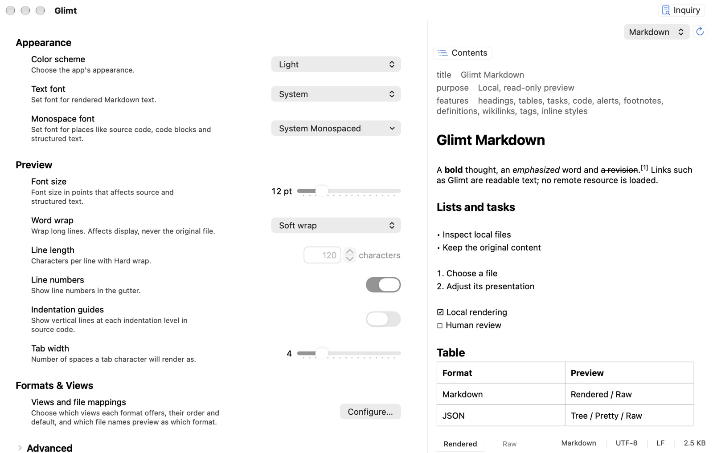

# Glimt

<p>
  <a href="https://github.com/HansJoakimPersson/Glimt/actions/workflows/ci.yml"></a>
  <a href="https://github.com/HansJoakimPersson/Glimt/actions/workflows/release.yml"></a>
  <a href="https://github.com/HansJoakimPersson/Glimt/releases"></a>
  <a href="https://github.com/HansJoakimPersson/Glimt/releases"></a>
  <a href="https://hansjoakimpersson.github.io/Glimt/"></a>
  <a href="LICENSE"></a>
  <a href="https://github.com/HansJoakimPersson/Glimt"></a>
  <a href="https://github.com/HansJoakimPersson/Glimt"></a>
  <a href="https://github.com/HansJoakimPersson/Glimt"></a>
  <a href="https://github.com/HansJoakimPersson/Glimt"></a>
  <a href="https://github.com/sponsors/hansjoakimpersson"></a>
</p>

Glimt is a file inspector for macOS. It shows source code, Markdown and structured data in its own
window, in Finder's Quick Look preview and as Finder thumbnails. Glimt is local and read-only: it
never runs or changes the files it shows, and it does not use the network.




## Features

- Syntax-highlighted source with line numbers for programming, markup, configuration and template
  languages.
- Rendered Markdown, including TextBundle packages, and Mermaid diagrams.
- Tree, Pretty and Table views for JSON, YAML, XML, property lists, CSV, logs, certificates,
  SQLite schemas and more. Archives are listed, never extracted.
- Quick Look previews and Finder thumbnails that use the same engine and settings as the app.
- **Formats & Views** to choose each format's views, their order and the default, and to map your
  own filenames and extensions.
- **Inquiry** shows how Glimt detected and read a file, with diagnostics you can copy into a report.
- Optional markers for changed lines in local Git and Subversion working copies (off by default).

## System Requirements

macOS 15 or later, on Apple silicon or Intel. Glimt needs no special permissions.

## Installation

Download the latest build from [GitHub Releases](https://github.com/HansJoakimPersson/Glimt/releases).
Glimt is in beta, so builds are published as pre-releases.

1. Download `Glimt-<version>-macOS.zip`.
2. Unzip it and move `Glimt.app` to `/Applications`.
3. Open Glimt. Beta builds are not notarized yet, so macOS blocks the first launch: choose
   **Done**, open **System Settings › Privacy & Security**, click **Open Anyway** next to the
   message about Glimt and confirm.
4. Check that Glimt is enabled under
   **System Settings › General › Login Items & Extensions › Quick Look**.

`Glimt › About Glimt` shows the installed version. To verify a download, save the release's
`Glimt-<version>-SHA256SUMS.txt` next to the zip and run `shasum -a 256 -c Glimt-<version>-SHA256SUMS.txt`.

## How to Use It

**In Finder**, select a file and press Space or open the Preview pane. When macOS uses Glimt for
the file, the tabs in the footer switch between its views, such as Source, Rendered, Tree and Raw.
Thumbnails use fixed defaults.

**In the app:**

- `File › Open File…` (⌘O) opens any file. Settings for appearance, fonts, wrapping and limits sit
  beside a live preview.
- `View › Formats & Views…` (⌘1) sets which views each format offers and which one opens first.
- **Inquiry** in the title bar shows the detected type, the inspector and diagnostics.
  **Copy Report** copies them for sharing.

Quick Look uses the same settings. Settings are stored in
`~/Library/Application Support/Glimt/settings.json`; **Reset All Settings…** restores the defaults
and cannot be undone. **Advanced › Debug logging** (off by default) writes
`~/Library/Logs/Glimt/Glimt.log`, without file contents, names or paths.

## Supported Formats

- **Source code and markup:** Swift, Python, JavaScript/TypeScript, C/C++, Java, Rust, Go, Shell,
  HTML, CSS, templates such as Jinja and ERB, and many more.
- **Documents:** Markdown, TextBundle, Mermaid, AsciiDoc, Org.
- **Data:** JSON, YAML, XML, TOML, property lists, CSV/TSV, JSON Lines, logs, iCalendar, vCard, email.
- **Specialist files:** certificates, software bills of materials, SQLite, ZIP and TAR, diffs.
- **Anything else:** plain text in Raw, binary files in Hex.

The [format masterlist](docs/formats/README.md) (in Swedish) lists every format with its views and
limits.

## Common Known Issues

**macOS says it cannot verify Glimt.** Beta builds are ad-hoc signed and not notarized. Approve
the first launch with **Open Anyway**, as described under Installation.

**Finder shows another preview.** macOS picks one Quick Look provider for each file type, and
another installed app may win even though Glimt can show the file. Check that Glimt is enabled
under Quick Look extensions, then open Glimt once. Inquiry's Quick Look diagnostics show what
macOS reported. `.ts` files are a known conflict, because macOS may treat them as MPEG video.

**A preview is blank, partial or only shows Raw or Hex.** The file may be malformed or larger than
Glimt's limits. Open it in the app and check Inquiry, or raise the data limit in Settings.

**No automatic updates.** Check [GitHub Releases](https://github.com/HansJoakimPersson/Glimt/releases)
for new builds.

## Uninstallation

Quit Glimt and move `Glimt.app` to the Trash. To remove settings and logs as well, delete
`~/Library/Application Support/Glimt/` and `~/Library/Logs/Glimt/`.

## Development

Glimt is an Xcode project: the app with its Quick Look Preview and Thumbnail extensions, built on
the `InspectorCore` Swift package. There is no root `Package.swift`, because SwiftPM cannot build
the app and its extensions. You need Xcode 27, Python 3 and ShellCheck (`brew install shellcheck`).

To run from source, open `Glimt.xcodeproj`, select the `Glimt` scheme and `My Mac`, and use
**Product › Run** with Xcode's **Sign to Run Locally**.

The Makefile gives local builds and GitHub Actions the same entry points; `make help` lists them.

```sh
make test      # the full unsigned gate: lint, InspectorCore, tooling and Xcode tests, bundle audit
make package   # signed, audited Release build in dist/ with its SHA-256 checksums
make version   # the version, tag and artifact names
```

`make package` refuses uncommitted changes and records the commit inside the app. CI runs
`make test` and `make package` on every push and pull request. `bash scripts/glimt-cleanup.sh`
lists Glimt copies and Quick Look registrations, for example ones Xcode leaves behind, without
changing anything.

### Releasing

`Config/Version.xcconfig` is the only place a version is written:

```
MARKETING_VERSION = 0.1.0          // MAJOR.MINOR.PATCH
CURRENT_PROJECT_VERSION = 1        // build number; raise it for every published build
GLIMT_PRERELEASE = beta.1          // alpha.N, beta.N, rc.N, or empty for a stable release
```

The tag (`v0.1.0-beta.1`), release title, About window and artifact names all derive from it. To
publish a release:

1. Set the new values, check them with `make version`, commit and push to `main`. Wait for CI.
2. Tag the commit and push the tag:

   ```sh
   git tag -a v0.1.0-beta.2 -m "Glimt 0.1.0 Beta 2"
   git push origin v0.1.0-beta.2
   ```

The release workflow rejects a tag that differs from the version file, builds and tests the tagged
commit, and verifies the artifact's checksums. It then publishes the zip and checksums with
GitHub's generated release notes. Notes for a pre-release start at the closest earlier release;
notes for a stable release start at the previous stable one. alpha, beta and rc builds are marked
as pre-releases. To add version-specific notes, edit the published release on GitHub.

A published release is never replaced, so publish a new build number instead. If the workflow fails
before publishing, fix `main` and move the tag to the fixed commit.

Without signing secrets, builds are ad-hoc signed and not notarized. To sign with a Developer ID
and notarize, add the `GLIMT_*` repository secrets listed in `.github/workflows/ci.yml`. Locally,
set `GLIMT_SIGN_IDENTITY`, `GLIMT_DEVELOPMENT_TEAM` and `GLIMT_NOTARY_PROFILE` (a `notarytool`
keychain profile) before `make package`. Never commit certificates, keys or provisioning profiles.

## Contributing

Issues and focused pull requests are welcome, especially for format detection and rendering, Finder
and Quick Look behavior, accessibility, and new formats that fit Glimt's local, read-only design.
Run `make test` before opening a pull request. Attach a small synthetic example file rather than a
private one.

## Support

If you want to support Glimt or whatever I build next:

- [GitHub Sponsors](https://github.com/sponsors/hansjoakimpersson)

## License

Glimt is licensed under the GNU Affero General Public License v3.0 (`AGPL-3.0`). See [`LICENSE`](LICENSE).
